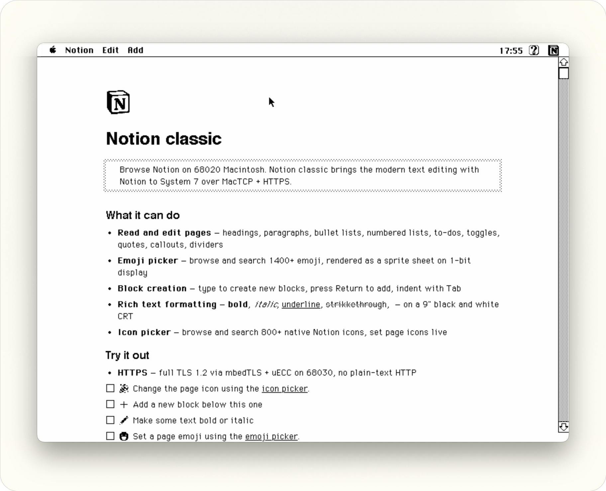

# Notion Classic

**A native Notion client for compact Macs from 1989.**

*For the ones who see things differently.*

Notion Classic reads and edits real Notion pages on a 68k Macintosh running System 7. It opens its own TLS 1.2 connection to `api.notion.com`, with no proxy and no modern machine in between. The 16 MHz 68030 does the cryptography itself, which is the hard part: a stock handshake needs 49 to 73 seconds of math on this CPU, and Cloudflare stops waiting after about 15.



> **Try it in your browser at [classic.slkk.nl](https://classic.slkk.nl).** It's a real 68k Mac running in a browser tab, on my own copy of [Infinite Mac](https://github.com/mihaip/infinite-mac) with a TCP/IP stack I added so it can make live API calls. Self-hosted on a Raspberry Pi 5. No vintage hardware needed.

There are three documents. This README is the overview. **[The story](docs/the-story.md)** covers the why: a 2022 side project, a three-year stall, and an AI that said to use a proxy. **[HTTPS on a 37-Year-Old Mac](https://github.com/SLKK-design/HTTPS-68K-Speedtest/blob/main/docs/modern-HTTPS-on-68k.md)**, in the HTTPS 68K Speedtest repo, covers the how: the handshake, the assembly, and a measured step-by-step history.

---

## What it does

- **Reads and edits Notion pages:** paragraphs, headings, to-dos, bullets, quotes, dividers and nested toggles, with formatting, links, page mentions, emoji and page icons.
- **Page library:** a tree of your pages with search, back/forward and recent pages; create, move and delete pages. Visited pages are cached on disk and show up instantly.
- **Edits that don't lose your text.** Formatting survives typing, Cmd-Z works like on any Mac, and failed or interrupted saves retry and finish once you reconnect. What the Mac can't fully show (an @person, a date, an equation) is marked *Read only*.
- **Fits on a floppy:** one file under 1 MB, 885 page icons included, so a 1.4 MB floppy holds it. The first release was 1.6 MB plus a folder of 1,316 icon files.
- **Debug console:** a live, timestamped log of every step, in Toolbox ticks.

The full v2.0 list is in the [changelog](CHANGELOG.md).

## How fast, and how I know

Measured on real hardware from the debug console (System 7.5.5, June 2026 build):

| Machine | Cold handshake | Resumed handshake |
|---|---|---|
| Mac SE/30 (68030 @ 16 MHz, 32-bit bus) | **6.9 s** | **0.93 s** |
| Mac Classic II (68030 @ 16 MHz, 16-bit bus) | **11.0 s** | **0.87 s** |

Cold means no session ticket, with the certificate check cached. The very first connection also checks the certificate's signature and takes about 8–11 s on the SE/30 and 13–14 s on the Classic II.

End to end, a cold boot to a rendered page takes about **26–30 s** on the SE/30. A refresh takes about **7–8 s** on the SE/30 and **12–13 s** on the Classic II (a 30-block page). A warm launch shows the cached page **immediately**.

Loading the next page is **up to 60 times faster** than stock mbedTLS: 0.85 s on the SE/30, where stock would have needed about 52 s, had the server waited that long. That's the whole page: connecting, the resumed handshake and the request.

*Measured on October 19, 2026, on Open Transport 1.3 with its TCP window-scale bug patched by [Open Transport Bug Patcher](https://github.com/SLKK-design/HTTPS-68K-Speedtest#open-transport-bug-patcher). Unpatched, Open Transport waits 3–4 s on every page from Cloudflare.*

Getting there took a chain of changes, roughly in this order: micro-ecc in place of mbedTLS's generic bignum code, a trust anchor that skips a P-384 verify the Mac can't afford, key generation moved off the critical path, Shamir's trick with wNAF for the signature verify ([Rivain 2011](https://eprint.iacr.org/2011/338.pdf)), and finally custom 68020 assembly for the 256-bit field multiply plus session tickets that actually resume and are kept on disk. Faster math makes each operation 4–7× faster, and a whole first handshake 7–8× with the trust pin and early key generation. The rest comes from not doing the same work twice.

## The short version of how this happened

In October 2022 I wrote the first version by hand, with no AI. I worked from *Macintosh C by Example*, old System 7 programming books, and Anthony Super's libraries. It worked in Basilisk II, where the "68k Mac" is really a modern CPU and a handshake takes 0.2 seconds. On the real Classic II, in April 2023, the handshake never finished, so I put a small Python proxy on the Raspberry Pi. Then I hit a Toolbox wall (scrolling a page built from many TextEdit fields) and shelved the project.

In early 2026 Claude Code fixed that scroll problem, and I wanted the proxy gone. When I asked Claude to make a real SE/30 do HTTPS on its own, it told me to use a proxy. I already had one. On March 24, 2026, after two days of photographing error codes off a 9-inch screen, the SE/30 loaded a Notion page by itself.

The full version is in **[the story](docs/the-story.md)**.

## Tested on

| Machine | Notes |
|---|---|
| Mac SE/30 (68030/16) | Primary target. BlueSCSI for storage and network. |
| Mac Classic II (68030/16, 16-bit bus) | The slowest machine I support. PiSCSI for storage and network. It was a copywriter's work machine before it was mine. |
| Macintosh mini | A Raspberry Pi Zero in a Maclock case running Basilisk II ([macintosh-mini](https://github.com/wr/macintosh-mini) by Wells Riley). I added networking so it can go online; my fork is at [SLKK-design/macintosh-mini](https://github.com/SLKK-design/macintosh-mini). |
| Basilisk II | Development emulator. The first runs used the project folder mounted as a disk. |
| SheepShaver, System 8.1 | Works through Open Transport's MacTCP compatibility layer. |
| PowerBook G4, Mac OS 9 Classic | Works. |

None of the real machines has an Ethernet card. The network arrives over **SCSI**: [PiSCSI](https://github.com/PiSCSI/piscsi) and [BlueSCSI](https://bluescsi.com/) emulate a [Dayna SCSI/Link adapter](https://github.com/PiSCSI/piscsi/wiki/SCSI-Network-Card), and MacTCP binds to it. Builds get from my modern Mac to the old ones through a 12" PowerBook G4 running OS X 10.4.6 with OS 9 Classic, the one machine here that speaks both eras.

## Requirements

| | |
|---|---|
| CPU | 68020 or later (the original 68000 Classic, Plus and SE can't run it) |
| App partition | 4 MB |
| System RAM | 8 MB or more (10 MB with a heavy extension set). Virtual Memory helps on tight machines. |
| OS | System 7.5 to 8.1. Also runs in Mac OS 9 Classic on a G4. |
| Network | Any MacTCP-compatible Ethernet card or adapter, or a Dayna-style SCSI network card emulated by PiSCSI or BlueSCSI |

On a 68k Mac with Open Transport 1.3, run [Open Transport Bug Patcher](https://github.com/SLKK-design/HTTPS-68K-Speedtest#open-transport-bug-patcher) once. Notion is behind Cloudflare, and Open Transport 1.3 mishandles Cloudflare's TCP window scale, so without the patch every page waits 3 to 4 seconds.

## Download

Get [NotionClassic.sit](https://github.com/SLKK-design/NotionClassic/releases/latest/download/NotionClassic.sit) (StuffIt, for the Mac itself) or [NotionClassic.zip](https://github.com/SLKK-design/NotionClassic/releases/latest/download/NotionClassic.zip) (for a modern Mac, which keeps the resource fork when it unzips) from the [latest release](https://github.com/SLKK-design/NotionClassic/releases/latest), and copy the app to the Mac. Then connect it to Notion, as below.

## Connecting to Notion

1. Create an internal integration at [notion.so/my-integrations](https://www.notion.so/my-integrations) and copy its secret.
2. In Notion, share the page you want with that integration (••• → Connections). Share only what this Mac should see.
3. Copy the page ID: the 32 hex characters at the end of the page URL.
4. Launch Notion Classic, open **Connection**, and paste the token and the page ID.

## A word on security

The connection is encrypted. The Mac is not protected. Classic Mac OS has no memory protection and no file permissions, so anything running on the machine can read the prefs file that holds your token. The app hasn't been exhaustively tested, and a bug could in principle make an API call you didn't ask for. Use a dedicated, scoped integration you can revoke, and don't point it at a workspace you care about. I built this for fun, and you should treat it as a toy.

## Building

You need [Retro68](https://github.com/autc04/Retro68). The 68k mbedTLS and MacTCPHelper libraries come pre-built in `src/core/lib/`.

```bash
cmake -S . -B build -DCMAKE_TOOLCHAIN_FILE=<Retro68-build>/toolchain/m68k-apple-macos/cmake/retro68.toolchain.cmake
make -C build
```

The app ends up in `build/` as `NotionClassic.APPL`. Copy it to the Mac with its resource fork intact: on a SCSI emulator image, a floppy, or over AppleShare. A plain copy through a modern filesystem drops the resource fork, and the app won't launch.

One warning from experience: don't trust emulator timings. Basilisk II finishes a handshake in 0.2 s. A real 68030 takes 7 to 11 s.

## Sibling project: Claude 68

The `src/core` engine (HTTP, TLS, prefs, allocator, grow-zone) is shared with **[Claude 68](https://github.com/SLKK-design/Claude68)**, a Claude chat client for the same machines that streams replies word by word.

The two apps prove different things. Notion Classic shows the engine can carry a heavy, stateful app: a Notion page read, edited and written back from a 9-inch CRT. Claude 68 is deliberately small. It's a boilerplate: change one config file and one API file, and you have an HTTPS and SSE client for a different API. Each repo carries its own copy of the engine, and `scripts/diff_core.sh` shows where the two have drifted apart.

## Credits

The 2022 version was written by hand. Everything since early 2026 was built with [Claude Code](https://claude.ai/code). It wrote most of the new code, including the 68k assembly, and explained the papers as we went. I set the goals, ran each build on the real machines, read the tick logs and decided what stayed. mbedTLS runs the protocol and the cipher. Some of the curve code is mine (the assembly, an X25519 rewrite, a faster signature check and the trust pin), and the [deep-dive](https://github.com/SLKK-design/HTTPS-68K-Speedtest/blob/main/docs/modern-HTTPS-on-68k.md) lists exactly what.

Built by **Lin van der Slikke**, standing on:

- [MacHTTP](https://github.com/antscode/MacHTTP), [mbedtls-Mac-68k](https://github.com/antscode/mbedtls-Mac-68k) and [MacTCPHelper](https://github.com/antscode/MacTCPHelper) by Anthony Super (antscode). MacHTTP is where the HTTP client started, and his classic-Mac Spotify remote is why this project exists at all. That remote, [MacPlayer](https://github.com/SLKK-design/MacPlayer), now runs again on this engine.
- [Retro68](https://github.com/autc04/Retro68) by Wolfgang Thaller, the 68k GCC toolchain
- [mbedTLS](https://github.com/Mbed-TLS/mbedtls) (ARM/Mbed, Apache 2.0)
- [micro-ecc](https://github.com/kmackay/micro-ecc) (Kenneth MacKay, BSD 2-clause)
- [curve25519-donna](https://github.com/agl/curve25519-donna) (Adam Langley / Google, BSD 3-clause)
- [http-parser](https://github.com/nodejs/http-parser) (Joyent / Node.js contributors, MIT), [yuarel](https://github.com/jackenl/yuarel) (Jack Engqvist Johansson, MIT), [gason](https://github.com/vivkin/gason) (Ivan Vashchaev, MIT)
- [Rivain (2011), *Fast and Regular Algorithms for Scalar Multiplication over Elliptic Curves*](https://eprint.iacr.org/2011/338.pdf)
- [PiSCSI](https://github.com/PiSCSI/piscsi) and [BlueSCSI](https://bluescsi.com/), for storage and the SCSI network card emulation that puts the real machines online
- [Infinite Mac](https://infinitemac.org) by Mihai Parparita, the platform behind the browser demo
- The Notion API team, for an API clean enough to parse on a Classic II

## License

My code is released under [0BSD](LICENSE): use it however you like, no credit needed. The bundled libraries keep their own licenses (see [THIRD_PARTY_LICENSES](THIRD_PARTY_LICENSES)). The Notion page icons belong to Notion Labs, and 0BSD doesn't cover them. The emoji are my own 1-bit redraw, using Microsoft's Segoe UI Emoji designs as a starting point.

---

*A Macintosh from 1989, talking to a 2026 API over real TLS. No proxy, no helper box. [See it for yourself.](https://classic.slkk.nl)*
